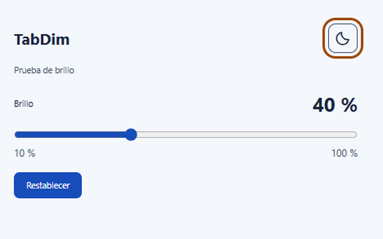
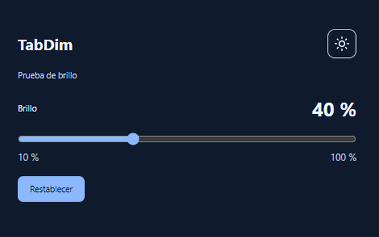

# TabDim

¿Una pestaña te deslumbra y otra está perfecta? Con TabDim, cada una va a su bola.

Extensión de Google Chrome con Manifest V3 que permite reducir el brillo visual de cada pestaña del **10 % al 100 %**, de forma independiente. Dos pestañas de la misma URL pueden tener ajustes diferentes.

- Cambios en tiempo real y restablecimiento con un clic.
- Conserva el brillo al recargar y navegar en la misma pestaña.
- Icono dinámico con indicador del brillo de la pestaña.
- Interfaz en español, modo claro/oscuro y botón sol/luna.
- Popup y ventana independiente vinculada a una pestaña concreta.
- Sin analítica, anuncios, código remoto ni datos enviados a servidores.

## Capturas

## Estado en Chrome Web Store

**Versión 1.1.1 enviada a Chrome Web Store y pendiente de aprobación por Google**, según confirmación de Vixovi. El enlace de instalación oficial se añadirá cuando esté disponible.

Este repositorio público permite revisar el código, su funcionamiento, los permisos y la privacidad de TabDim.

## Probar el código localmente

Para revisar su funcionamiento durante la espera, descarga `TabDim.zip`, extráelo y abre `chrome://extensions`. Activa **Modo de desarrollador**, pulsa **Cargar descomprimida** y elige la carpeta con `manifest.json`. Chrome mínimo: 123. También puedes cargar esta carpeta del repositorio, que contiene el código y los iconos.

Usa el icono de la extensión para ajustar la pestaña activa. El menú «Ajustar brillo de esta pestaña» aparece en la barra de pestañas cuando Chrome admite el contexto `tab`; en versiones anteriores se ofrece dentro de la página. El control independiente mantiene su objetivo aunque actives otra pestaña.

## Código y documentación

El código de la extensión está disponible en la raíz del repositorio; los iconos están en `icons/`. `TabDim-fuentes.zip` contiene el proyecto completo con pruebas, scripts de empaquetado, documentación y recursos gráficos. No incluye perfiles temporales de navegador.

- [Manual y permisos](MANUAL.md)
- [Resultados y límites de las pruebas](VERIFICACION.md)
- [Ficha y descripción para la tienda](FICHA.md)
- [Política de privacidad](PRIVACIDAD.md)
- `TabDim-WebStore-1.1.1.zip`: copia del paquete 1.1.1 ya enviado por Vixovi, conservada como referencia para revisar esa versión.

## Privacidad y límites

El brillo se guarda por ID en `storage.session` y se borra al reiniciar Chrome, recargar/desactivar la extensión o cerrar la pestaña. La apariencia se conserva en `storage.local`. Los títulos y metadatos de las pestañas se usan localmente para la función; no se guarda historial de navegación ni se transmite información a servidores.

Chrome impide la inyección en páginas protegidas como `chrome://` y Chrome Web Store. Vídeos/iframes en pantalla completa, Picture-in-Picture y elementos de la capa superior pueden quedar fuera del oscurecimiento. La extensión añade una capa con `pointer-events: none` al documento principal, sin cambiar los filtros CSS originales.

Las pruebas automatizadas se ejecutaron en Chromium 148. El menú nativo y el cambio visual de icono en el Chrome instalado no se verificaron automáticamente. Consulta el informe para el alcance completo. El envío a Chrome Web Store está realizado; la aprobación continúa pendiente.

Desarrollador: **Vixovi** · Soporte: **Vixovi@proton.me**.
